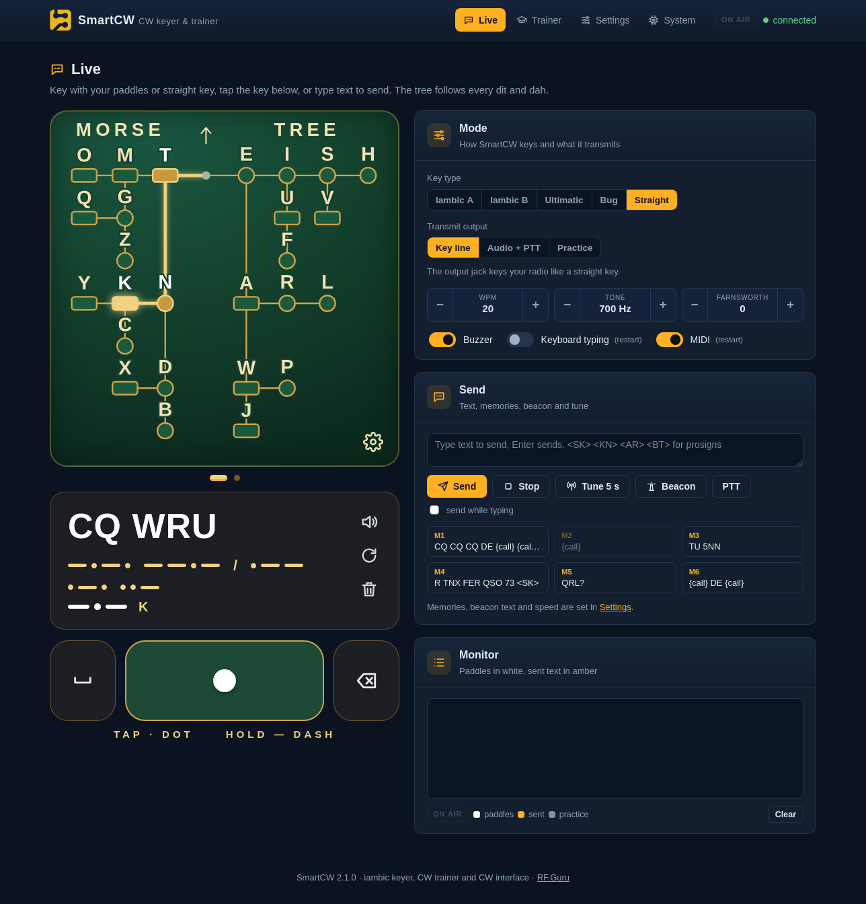
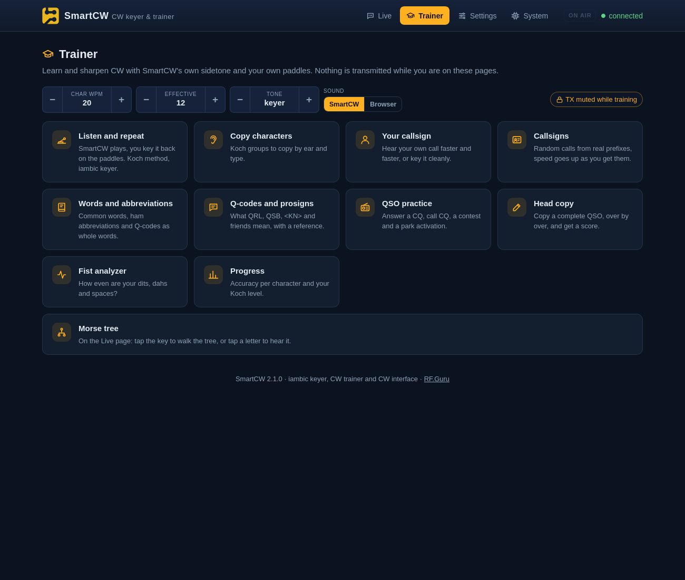
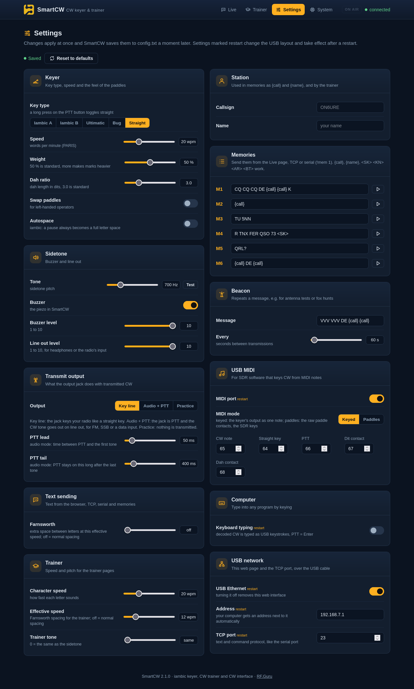

# SmartCW – Iambic Keyer, CW Trainer and CW Interface

SmartCW is a USB-C iambic keyer, CW trainer and CW interface for radios and SDR software, with its own sidetone. Plug in paddles or a straight key, plug in USB, and SmartCW keys your transceiver, your SDR software (over MIDI) or types what you key as text, while sending anything you type as Morse.

Over the same USB-C cable it is also a small network adapter with a **web interface** in the RF.Guru style: the visual Morse tree, every setting, operating modes and a complete CW trainer, at **http://smartcw.local/** (or http://192.168.7.1/). No drivers, no app, no internet connection needed.

The firmware is C++ for the RP2040 (Arduino core by earlephilhower, built with PlatformIO), structured like [SmartFOX](https://github.com/Guru-RF/SmartFOX). All settings live in a plain `config.txt`.

Buy here: [SmartCW – RF.Guru shop](https://shop.rf.guru)



---

## 🧠 What it does

- **Keyer**: iambic A, iambic B, ultimatic, bug or straight key on the paddle jack, with weighting, dah ratio, paddle swap and autospace. A long press on PTT switches to straight key and back.
- **Speed on the box**: hold PTT and tap the dit paddle (slower) or the dah paddle (faster); SmartCW says the new speed on the sidetone when you let go. No computer needed.
- **Transmit output**, three ways: the jack **keys the radio** like a straight key, or it is **PTT with the CW tone on line out** (audio mode, for FM, SSB or a data input, with PTT lead and tail), or **practice** (nothing transmitted). Keying compensation and first-element extension for QSK radios.
- **Sidetone** on the piezo and the line-out jack, pitch and level adjustable.
- **Decodes what you key** (adaptive for straight key) and sends it to the computer over USB serial, TCP and the web page.
- **Sends text as CW**: from the web page, serial, TCP or the ten memories, with Farnsworth spacing and prosigns like `<SK>`, `<KN>`, `<AR>`, `<BT>`.
- **Contest loggers**: SmartCW answers as a **WinKeyer** on its serial port (N1MM+, DXLog, Win-Test, fldigi, CQRLOG and every other WinKeyer logger) and as **cwdaemon** over the USB network (CQRLOG, TLF, xlog). Memories send a **contest serial number** with `{nr}`, with cut numbers (0 as T, 9 as N).
- **USB MIDI** for SDR software: the keyer's output as one note, or the raw paddle contacts as two notes; a PTT note.
- **USB keyboard**: decoded CW is typed into whatever window has focus, PTT = Enter.
- **Internet CW**: the paddles become the Left and Right Ctrl keys that **vBand** and **Vail** listen for, or Vail's MIDI notes.
- **Beacon**: repeats a message every N seconds; a paddle press stops it.
- **Tune**: key down for up to 20 seconds.
- **CW trainer** in the browser: listen and repeat, copy, your own call, callsigns, words, Q-codes, QSO practice, head copy, your own text, a fist analyzer and progress per character.
- **Web interface and TCP port** over USB Ethernet (see below), and a USB drive mode for editing `config.txt`.

The paddles always win: pressing a paddle aborts any text, beacon or tune in progress.

MIDI, keyboard mode, WinKeyer, cwdaemon, the serial/TCP protocol and the web API are described in [INTEROP.md](INTEROP.md).

---

## 🌐 Web interface

Plug SmartCW in and open **http://smartcw.local/** or **http://192.168.7.1/**. SmartCW gives your computer an address next to it by itself (192.168.7.16 and up); it hands out no gateway and no DNS server, so your normal internet connection is not touched. Linux, macOS and Windows 10/11 support the USB network natively.

`smartcw.local` is answered by SmartCW's own mDNS responder for IPv4 and for its IPv6 link-local address, so it resolves at once through Avahi (Linux), Bonjour (macOS) and Windows. SmartCW also announces itself with DNS-SD: service browsers (`avahi-browse -a`, Bonjour browsers, file managers) list **SmartCW** as a *Web Site* and as a *Telnet* service for the TCP port.

| Page | What is on it |
| --- | --- |
| **Live** | The visual Morse tree (follows every dit and dah from your paddles, tap a letter to hear it, swipe for numbers and signs), the decoded text with its Morse, an on-screen key (tap = dot, hold = dash), key type and output mode, speed and tone, text sending, memories, beacon, tune, PTT and a monitor of everything sent and received |
| **Trainer** | Listen and repeat (Koch method, iambic keyer), copy characters, your own callsign, callsigns, words and abbreviations, Q-codes and prosigns, QSO practice (answer a CQ, call CQ, contest, park hunter), head copy of a complete QSO, your own text, a fist analyzer and progress per character |
| **Settings** | Every setting, applied at once and saved to `config.txt` a moment later, with a **Reset to defaults** button that keeps your callsign, name and memories |
| **System** | Status, a command console, backup and restore of `config.txt`, firmware update and how to connect SDR software, loggers and internet CW |

The trainer pages hold **practice mode** while they are open: SmartCW never transmits during training, and transmits normally again within ten seconds after you leave. Trainer speed (character and effective wpm) and pitch are separate from the keyer settings. Progress is kept in the browser and can be exported.

| Trainer | Settings |
| --- | --- |
|  |  |

---

## 🔌 Boot modes

What is pressed while you plug in the USB-C cable selects the mode for that session:

| Held while plugging in | Result |
| --- | --- |
| nothing | Normal: serial port, MIDI and USB Ethernet (as enabled in `config.txt`) |
| **both paddles** | Normal **plus** a USB drive named `SMARTCW` containing `config.txt` |
| **PTT button** | Normal **plus** a USB keyboard: decoded CW is typed as keystrokes, PTT = Enter (or the paddles as Ctrl keys with `keyboardMode: ctrl`) |

Keyboard mode can be made permanent with `keyboard: true`. The drive can also be exposed at runtime with the `!drive` command.

When the host **ejects** the `SMARTCW` drive, SmartCW reboots and applies the edited `config.txt`. Use the file manager's *Eject* (macOS / Windows / GNOME), not a plain unmount: a bare `umount` does not send the SCSI eject, so send `!reboot` or re-plug the cable instead. Avoid *Safely Remove / power off* on Linux hubs with per-port power switching: it cuts power to the device. While the drive is exposed SmartCW never writes to its own filesystem, so edits from the host cannot collide with its own.

---

## 🔘 PTT button

| Press | Normal mode | Keyboard mode |
| --- | --- | --- |
| short (released before 1.5 s) | MIDI PTT pulse: note `midiPttNote` on, off 150 ms later; PWR + SER2 LEDs flash | types Enter |
| long (held 1.5 s) | toggles straight key and the paddle keyer: 1 beep = keyer, 2 beeps = straight; saved | same |
| held, tap a paddle | dit = 1 wpm slower, dah = 1 wpm faster; the new speed is played on the sidetone when you let go (never transmitted); saved | same |

While a logger has SmartCW open as a WinKeyer, the PTT speed change acts as WinKeyer's speed pot and the button is reported as pushbutton 1.

## 🔑 Key types and output

The paddle jack takes paddles (dit on tip, dah on ring, `paddleSwap` for left-handers) or a straight key (tip, ring or both closed = key down, so a mono plug works).

| `keyer` | Behaviour |
| --- | --- |
| `iambicA` | squeeze keying, no extra element when you release both paddles |
| `iambicB` | squeeze keying with the extra opposite element (the classic Curtis B) |
| `ultimatic` | when both paddles are held, the last one pressed wins |
| `bug` | dit paddle sends automatic dits, dah paddle is a manual key |
| `straight` | everything follows the key; decoding adapts to your speed |

| `output` | The output jack | Line out |
| --- | --- | --- |
| `key` | keys the radio like a straight key | sidetone |
| `audio` | is PTT: on `pttLead` ms before the first tone, off `pttTail` ms after the last | the CW tone that goes on air |
| `off` | idle (practice) | sidetone |

`keyComp` adds a fixed number of milliseconds to every transmitted dit and dah and takes it off the space after it, for QSK radios that shorten elements. `firstExt` lengthens the first dit or dah after a pause, for radios that clip it while they switch to transmit. Both work like the WinKeyer settings of the same name and only touch what goes on air.

All timing runs in a 1 kHz interrupt, independent of USB and network traffic: at 20 wpm dits are 60 ms, dahs 180 ms, gaps 60 ms, measured over MIDI.

---

## 🛠 Configuration – `config.txt`

Every setting can be changed in the web interface, with `!<setting> <value>` over serial or TCP (`!wpm 22`), or by editing `config.txt` on the `SMARTCW` drive. The file documents itself; delete it and eject to regenerate the defaults. Settings marked *restart* change the USB layout and apply after a restart.

| Setting | Default | Range / options | What it does |
| --- | --- | --- | --- |
| `keyer` | `iambicB` | iambicA, iambicB, ultimatic, bug, straight | key type on the paddle jack; a long press (1.5 s) on PTT toggles straight |
| `wpm` | `18` | 5..99 | keyer and text speed, words per minute |
| `weight` | `50` | 25..75 | mark/space weighting in %, 50 = standard |
| `ratio` | `30` | 25..45 | dah length in tenths of a dit, 30 = 3.0 |
| `paddleSwap` | `off` | on, off | swap the dit and dah paddles |
| `autoSpace` | `off` | on, off | iambic: wait for a full letter space after a pause |
| `tone` | `600` | 300..2000 | sidetone frequency in Hz |
| `buzzer` | `on` | on, off | piezo buzzer on/off |
| `volume` | `10` | 1..10 | buzzer level 1..10 |
| `lineLevel` | `10` | 1..10 | line out level 1..10 |
| `output` | `key` | key, audio, off | key = output keys the radio, audio = output is PTT and the tone goes out on line out, off = practice |
| `pttLead` | `50` | 0..500 | audio mode: ms between PTT and the first tone |
| `pttTail` | `400` | 0..3000 | audio mode: ms PTT stays on after the last tone |
| `keyComp` | `0` | 0..50 | ms added to every transmitted dit and dah (QSK), taken from the space after it |
| `firstExt` | `0` | 0..150 | ms added to the first dit or dah after a pause, for radios that clip it |
| `farnsworth` | `0` | 0..60 | text sending: effective wpm for the spacing, 0 = off |
| `trainWpm` | `20` | 5..60 | trainer character speed, wpm |
| `trainEff` | `12` | 0..60 | trainer effective (Farnsworth) speed, 0 = off |
| `trainTone` | `0` | 0..2000 | trainer tone in Hz, 0 = same as the sidetone |
| `midi` | `on` | on, off | USB MIDI port (restart) |
| `midiMode` | `keyed` | keyed, paddles | keyed = keyer output as one note, paddles = raw paddle contacts as two notes |
| `midiCwNote` | `65` | 0..127 | note held while the keyer or text keys down |
| `midiStraightNote` | `64` | 0..127 | note held while the straight key is closed |
| `midiPttNote` | `66` | 0..127 | note pulsed by the PTT button, held during audio-mode PTT |
| `midiDitNote` | `67` | 0..127 | paddles mode: dit contact |
| `midiDahNote` | `68` | 0..127 | paddles mode: dah contact |
| `keyboard` | `off` | on, off | USB keyboard (holding PTT while plugging in turns it on once) (restart) |
| `keyboardMode` | `text` | text, ctrl | text = decoded CW is typed, PTT = Enter; ctrl = paddles as Left/Right Ctrl keys for vBand and Vail |
| `winkeyer` | `on` | on, off | answer WinKeyer commands on the USB serial port, for contest loggers |
| `call` | `(empty)` | text, 15 chars | your callsign |
| `name` | `(empty)` | text, 19 chars | your name |
| `mem1` | `CQ CQ CQ DE {call} {call} K` | text, 71 chars | memory 1, {call}, {name} and {nr} are filled in |
| `mem2` | `{call}` | text, 71 chars | memory 2, {call}, {name} and {nr} are filled in |
| `mem3` | `TU 5NN` | text, 71 chars | memory 3, {call}, {name} and {nr} are filled in |
| `mem4` | `R TNX FER QSO 73 <SK>` | text, 71 chars | memory 4, {call}, {name} and {nr} are filled in |
| `mem5` | `QRL?` | text, 71 chars | memory 5, {call}, {name} and {nr} are filled in |
| `mem6` | `{call} DE {call}` | text, 71 chars | memory 6, {call}, {name} and {nr} are filled in |
| `mem7` | `5NN {nr}` | text, 71 chars | memory 7, {call}, {name} and {nr} are filled in |
| `mem8` | `{lastnr} {lastnr}` | text, 71 chars | memory 8, {call}, {name} and {nr} are filled in |
| `mem9` | `AGN?` | text, 71 chars | memory 9, {call}, {name} and {nr} are filled in |
| `mem10` | `QRZ?` | text, 71 chars | memory 10, {call}, {name} and {nr} are filled in |
| `nr` | `1` | 1..9999 | contest serial number, {nr} sends it and moves on, {lastnr} repeats the last one |
| `cutNumbers` | `off` | off, t, tn | serial numbers: t = send 0 as T, tn = also 9 as N |
| `beaconText` | `VVV VVV DE {call} {call}` | text, 71 chars | beacon message |
| `beaconEvery` | `60` | 5..3600 | seconds between beacon transmissions |
| `network` | `on` | on, off | USB Ethernet with the web interface and TCP port (restart) |
| `ip` | `192.168.7.1` | text, 15 chars | SmartCW's address; the computer gets the next free one from its DHCP server (/24) (restart) |
| `tcpPort` | `23` | 1..65535 | TCP port for the text/command protocol (restart) |
| `cwdaemonPort` | `6789` | 0..65535 | cwdaemon UDP port for Linux loggers, 0 = off (restart) |

Memories, the beacon text and the trainer understand `{call}` and `{name}`, and prosigns written as `<SK>`, `<KN>`, `<AR>`, `<BT>`, `<AS>`, `<BK>`, `<HH>`. Memories also understand `{nr}`, the contest serial number: it is sent as three digits (`001`, or `TT1` with `cutNumbers: t`) and moves on to the next number once the memory is sent; `{lastnr}` repeats the previous one when someone asks again. Set the number for a new contest on the Live page, in Settings or with `!nr 1`.

---

## 🗣 Serial and TCP protocol

The USB serial port (any baud rate) and TCP port 23 (`nc 192.168.7.1 23`, `telnet 192.168.7.1`) speak the same protocol:

- Any character you send is keyed as CW and echoed back when it is sent.
- Whatever you key on the paddles comes back as decoded text (`¿` for an unknown pattern).
- A line starting with `!` is a command; every response line starts with `!`.

| Command | Effect |
| --- | --- |
| `!help` | list of commands |
| `!status` | settings, USB and network in words |
| `!state` | everything as one JSON line |
| `!get [setting]`, `!<setting> [value]` | show or change any setting, e.g. `!wpm 22`, `!tone 650`, `!keyer iambicA` |
| `!send <text>`, `!mem <1..10>` | send text or a memory |
| `!nr [n]` | show or set the contest serial number |
| `!beacon on/off`, `!tune [s/off]`, `!practice on/off` | beacon, tune (default 5 s), practice mode |
| `!ptt`, `!stop` | PTT pulse; abort text, tune and beacon |
| `!save`, `!defaults [all]` | write `config.txt` now (changes also save themselves); factory settings, `all` also clears call and memories |
| `!net`, `!drive`, `!reboot`, `!bootloader` | network status, expose the drive, restart, firmware update mode (`!reboot` and `!bootloader` save a pending change first) |
| `!version`, `!id` | firmware version; the RF.Guru serial number (`!id set <serial>` on the bench, also the USB serial number; firmware updates and factory settings keep it) |
| `!inputs`, `!selftest` | hardware check: raw paddle and PTT contacts (`!inputs dit 0 dah 0 ptt 0`); each LED in turn and a beep, then `!selftest done` |
| `!perf` | longest main-loop stalls since the last `!perf` (diagnostics) |

---

## 🎹 MIDI

With `midi: true` SmartCW presents a USB MIDI port named `SmartCW`, channel 1:

| Event | MIDI (defaults) |
| --- | --- |
| key down / up, paddles or text, `midiMode: keyed` | note on / off `midiCwNote` (65), velocity 127 |
| straight key closed / open | note on / off `midiStraightNote` (64) |
| dit / dah paddle contact, `midiMode: paddles` | note on / off `midiDitNote` (67) / `midiDahNote` (68) |
| PTT button | note `midiPttNote` (66) on, off 150 ms later |
| audio-mode PTT | note `midiPttNote` held while PTT is on |

Nothing is sent over MIDI in practice mode or while a trainer page is open.

For **Vail** over MIDI, press *Vail notes* in Settings → USB MIDI (key and straight key = note 0, dit = note 1, dah = note 2): in keyed mode pick *Straight key* as Vail's keyer, in paddles mode Vail does the keying.

---

## 🏆 Contest loggers

**WinKeyer.** SmartCW's USB serial port also speaks the K1EL WinKeyer 2 protocol. In a logger with WinKeyer support (N1MM+, DXLog, Win-Test, fldigi, CQRLOG, Log4OM, UcxLog, RUMlogNG, MacLoggerDX, ...), choose SmartCW's serial port (`COMx`, `/dev/ttyACM0`, `/dev/tty.usbmodem…`) as the WinKeyer, at the usual 1200 baud. The logger's first WinKeyer command switches the port over; when the logger closes it, the port is SmartCW's text protocol again.

While a logger has it open:

- the logger's speed, weight, dah ratio, tone, key mode, PTT lead/tail, keying compensation and first extension are used. SmartCW's own settings are left alone and come back when the logger closes. A straight key stays a straight key.
- the paddles break in as on a real WinKeyer: they stop the logger's message and clear its buffer, and what you key is echoed to the logger.
- hold PTT and tap a paddle to change speed: the logger sees it as the speed pot.
- the web page shows a blue bar, and settings changed there still stick.

The web interface, MIDI, TCP and the trainer keep working next to the logger. Set `winkeyer: false` if another program on the serial port gets confused by it.

**cwdaemon.** Linux loggers that key through cwdaemon (CQRLOG, TLF, xlog, KLog) can send to SmartCW directly over the USB network: set the cwdaemon host to `192.168.7.1` (or `smartcw.local`) and port `6789`. Speed, tone, weight, tune, abort and the reply requests are supported.

## 🌍 Internet CW (vBand, Vail)

Set **USB keyboard** on and **Keyboard sends: Paddle keys** (`keyboard: true`, `keyboardMode: ctrl`, restart once). The dit and dah paddles then press the **Left and Right Ctrl** keys, which is what vBand and Vail listen for; a straight key presses Left Ctrl. Choose the keyer in vBand or Vail (for a straight key: *Straight key*). Nothing is pressed while a trainer page is open. Vail also works over MIDI, see above.

---

## 💡 LEDs

| LED | Meaning |
| --- | --- |
| PWR | on when running; off while text is being sent |
| DIT | on while a dit is keyed (or the straight key is closed) |
| DAH | on while a dah is keyed |
| SER | on while text, a memory or the beacon is being sent |
| SER2 | audio-mode PTT; flashes with PWR when PTT is pressed |

---

## 🔁 Firmware update

Pre-built UF2 files are attached to every [GitHub release](https://github.com/Guru-RF/SmartCW/releases). Settings are kept.

- **Web**: System → *Restart into update mode*, then drag `smartcw-*.uf2` onto the `RPI-RP2` drive.
- **Command**: send `!bootloader` over serial or TCP, then drag the UF2 onto `RPI-RP2`.
- **Config file**: boot with both paddles held, replace the contents of `config.txt` with the single word `firmwareupdate`, eject.
- **BOOTSEL (recovery)**: unplug, hold BOOTSEL, plug in, release; drag the UF2 onto `RPI-RP2`.

`flash_nuke.uf2` (shipped with every release) erases the whole flash, including `config.txt`; flash the regular firmware afterwards.

---

## 🧑‍💻 Building from source

Requires [PlatformIO](https://platformio.org/install) (`pip install platformio`).

```bash
pio run -e pico                 # build -> .pio/build/pico/firmware.uf2
pio run -e pico -t upload       # build + flash (device in RPI-RP2 mode)
pio device monitor              # serial console
```

The web interface lives in `web/` (plain HTML, CSS and JavaScript, no build tools). `tools/build_web.py` runs before every build: it inlines the scripts and styles into one page, gzips it and generates `src/web_assets.h`.

Every push to `main` and every tag is built by GitHub Actions (`.github/workflows/build.yml`); a tag like `v2.1.0` attaches the UF2 to the matching release.

### Source layout

| File | Role |
| --- | --- |
| `src/main.cpp` | boot modes, start-up, main loop |
| `src/engine.*` | real-time engine in a 1 kHz interrupt: keyer modes, decoder, text player, tune, beeps |
| `src/output.*` | sidetone, key line, audio-mode PTT with lead and tail |
| `src/hub.*` | engine events to MIDI, serial, TCP, web and keyboard; beacon, memories |
| `src/config.*` | settings table, `config.txt` reader/writer, JSON, auto-save |
| `src/cli.*` | the serial/TCP protocol and `!` commands |
| `src/net.*` | USB Ethernet (CDC-NCM, IPv4 + IPv6 link-local), DHCP server, mDNS / DNS-SD, TCP port |
| `src/crash.*` | remembers a panic or hard fault across the restart, reported by `!status` |
| `src/web.*` | web server, JSON API, live event stream |
| `src/dhcps.*` | DHCP server (from MicroPython, without gateway and DNS) |
| `src/morse.*` | Morse table with prosigns |
| `src/ptt.*`, `src/leds.*`, `src/usbio.*` | PTT button, LEDs, USB MIDI / keyboard / drive |
| `web/` | the web interface; `web/js/data.js` holds the trainer content |
| `tools/build_web.py` | bundles `web/` into the firmware |

### Hardware map

| Function | GPIO |
| --- | --- |
| Dit paddle | 13 |
| Dah paddle | 12 |
| PTT button | 16 |
| CW key / PTT output | 14 |
| Sidetone piezo | 24 |
| Sidetone / TX audio line out | 15 |
| LED PWR / DAH / DIT / SER / SER2 | 3 / 8 / 11 / 10 / 7 |

Inputs are active-low with internal pull-ups; LEDs are active-low.

---

## Credits

- The iambic keyer logic started from [xiaoKey](https://github.com/MarkWoodworth/xiaokey) by Mark Woodworth (AC9YW), MIT licensed.
- The DHCP server is MicroPython's (Damien P. George), MIT licensed, as shipped in arduino-pico.
- The visual Morse tree layout follows the classic dichotomic Morse tree.
