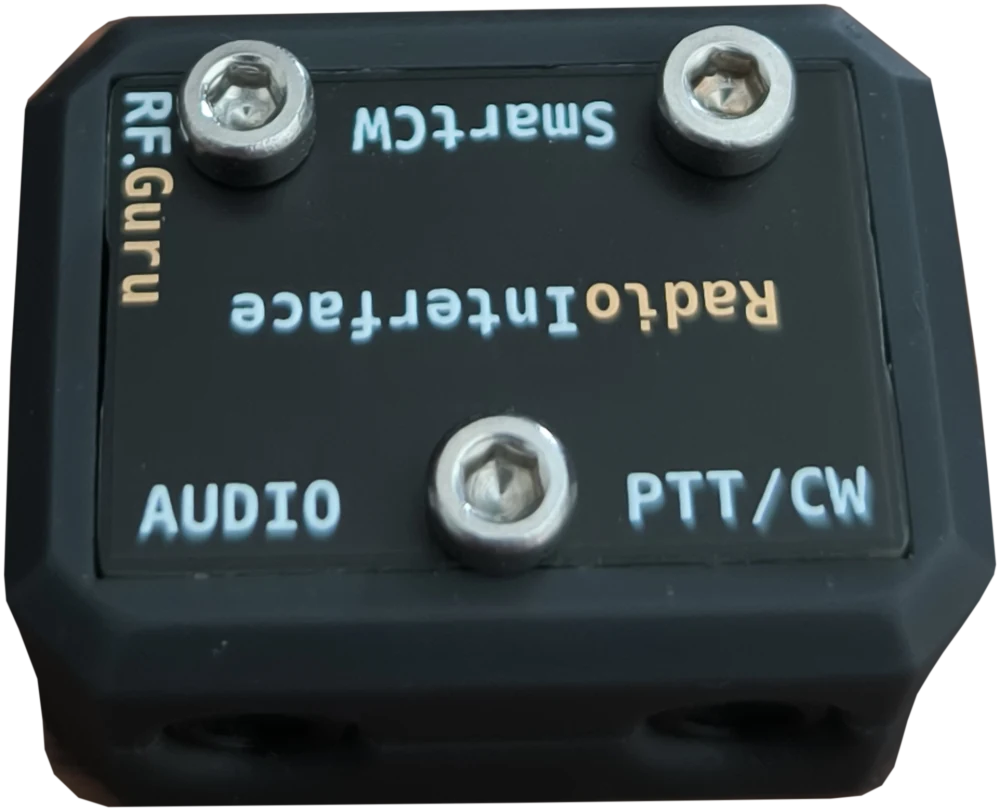

# 3. Connecting a radio

## The CW jack and the Radio Interface

The CW jack carries two things: the **key / PTT line** and **line out**, the audio with the sidetone or the transmit tone. The small black box in the kit, the RF.Guru **SmartCW Radio Interface**, splits them into two jacks for the radio. Its cable goes from its **SmartCW** jack to the CW jack on SmartCW.

| Jack on the Radio Interface | Carries | Goes to |
| --- | --- | --- |
| **PTT/CW** | the key / PTT line: the radio's key in *Key line* mode, its PTT in *Audio + PTT* mode | the radio's straight-key input, or its PTT |
| **AUDIO** | line out | the radio's microphone, data or line input; or headphones, for the sidetone |

One jack serves as key or as PTT: which one depends on the output mode below. With a plain CW radio only PTT/CW is needed.

## Three output modes

Settings → Transmit output, or `!output key|audio|off`.

| Mode | The CW jack | Line out |
| --- | --- | --- |
| **Key line** (`key`, default) | keys the radio like a straight key: the radio does the CW | the sidetone |
| **Audio + PTT** (`audio`) | is PTT: on `pttLead` ms before the first tone, off `pttTail` ms after the last | the CW tone that goes on the air, plus the sidetone when `lineSidetone` is on |
| **Practice** (`off`) | stays idle, nothing is transmitted | the sidetone |

**Key line** is the normal way for a CW radio: set the radio for a straight key (not for a paddle, or its own keyer would try to key the keyer), connect PTT/CW to its key input, done. The radio makes its own sidetone, so you may want SmartCW's buzzer off.

**Audio + PTT** is for an FM or SSB radio, a data interface or any transmitter that has no key input: SmartCW raises PTT, waits `pttLead` (default 50 ms), sends the CW as an audio tone on line out at `tone` Hz, and drops PTT `pttTail` (default 400 ms) after the last element so a string of letters does not pump the relay. Set the line out level (`lineLevel`, 1 to 10) for the radio's input, and the pitch (`tone`) to where the radio's filter wants it. Turn `lineSidetone` on if you also want to hear what you key on line out; it is off by default so that nothing but the TX tone goes to the radio.

**Practice** is for training with a radio attached. The trainer pages hold it by themselves while they are open (see [chapter 5](05-trainer.md)).

## Sidetone

The piezo in the box and line out both carry the sidetone, each with its own level (`volume` and `lineLevel`, 1 to 10) and the same pitch (`tone`, 300 to 2000 Hz). `buzzer: off` silences the piezo. The browser can play it as well, see [chapter 4](04-web-interface.md).

## QSK timing

Two settings touch only what goes on the air, as the WinKeyer settings of the same name:

- **Keying compensation** (`keyComp`, 0 to 50 ms) adds a fixed time to every transmitted dit and dah and takes it off the space after it, for radios that shorten elements in full break-in.
- **First extension** (`firstExt`, 0 to 150 ms) lengthens the first dit or dah after a pause, for radios that clip it while they switch to transmit.
